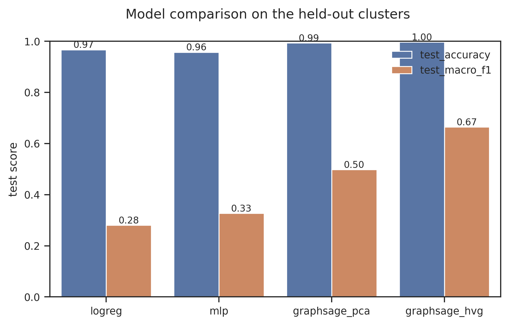
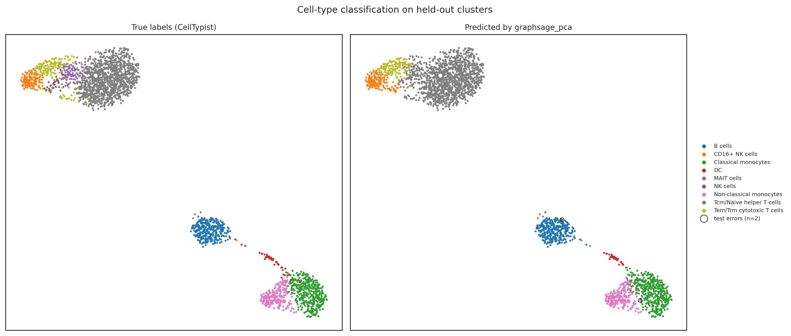

# Deep learning vs classical ML for single-cell cell-type classification


A rigorous comparative study: can a **Graph Neural Network** beat classical
baselines at predicting immune cell types from single-cell RNA-seq data?
Built as a companion to a standard Scanpy pipeline project on the same
public dataset (**10x Genomics PBMC 3k**, ~2,600 cells after QC).

The point of this project is not to maximise a metric — it is a clean
experimental protocol: same data, same split, same seeds, honest reporting
of when deep learning wins and when it does not.

## Overview

Cell-type annotation is usually done by unsupervised clustering plus marker
inspection, or by reference-based classifiers (e.g. CellTypist, which
provides our ground-truth labels here). A GNN can in principle exploit
**cell-cell similarity structure** that per-cell classifiers ignore. This
study tests whether that actually helps, against strong classical baselines,
under a deliberately hard evaluation: whole subpopulations held out of
training.

## Method

**Graph construction — cell-cell k-NN graph in PCA space (k=15).**
Cells are nodes; edges connect each cell to its 15 nearest neighbours in
the 50-component PCA space (symmetrised, unweighted, no self-loops). This
mirrors the neighbourhood graph underlying Leiden clustering and UMAP, so
edges encode biologically meaningful cell-state similarity. The graph is
sparse (~40k edges for ~2,600 cells), making CPU training fast. A bipartite
cell-gene graph was considered and rejected: it conflates features with
topology, is far heavier, and is not standard for cell typing. The graph is
built from the features of all cells with labels masked — the standard
**transductive** protocol of node-classification benchmarks; this
assumption is stated, not hidden.

**Evaluation — whole-cluster holdout, not random cell splits.**
Cells are not split randomly: entire Leiden clusters are assigned to
train/val/test (70/15/15 of cells), so the test set contains
*subpopulations never seen during training*. A label can only appear in
val/test if another cluster of the same label remains in train — the model
must generalise across subpopulations, not interpolate between near-duplicate
cells. Random cell-level splitting was rejected because a cell and its
nearest neighbour landing in different splits makes the task artificially
easy and inflates every model's score.

**Labels.** Fine-grained CellTypist annotations (`Immune_All_Low`,
majority voting over Leiden clusters); labels with fewer than 20 cells are
dropped. Fine labels are what make the error analysis interesting
(CD4+ vs CD8+ T cells, NK vs cytotoxic T).

## Models compared

| # | Model | Features | Type |
|---|---|---|---|
| 1 | Logistic regression (scikit-learn) | 50 PCs | linear baseline |
| 2 | MLP (2 hidden layers) | 50 PCs | per-cell deep baseline |
| 3 | GraphSAGE (2 layers) | 50 PCs | GNN |
| 4 | GraphSAGE (2 layers) | top 2000 HVG expression | GNN, richer features |

Same split and seed for all; early stopping on validation macro F1 for the
torch models. Metrics: accuracy, macro F1, per-class F1, normalised
confusion matrix, training time. Every run appends to
`results/experiments.csv`; the best checkpoint is saved as
`results/best_model.pt`.

## Quickstart

Requirements: Linux or macOS (Windows: use WSL2),
[Miniforge](https://github.com/conda-forge/miniforge), ~2 GB of disk.

```bash
git clone https://github.com/mounemhf/deep-learning-scrna-classification.git
cd deep-learning-scrna-classification

mamba env create -f environment.yml   # pinned stack, incl. PyTorch 2.5 CPU
conda activate dl-scrna

bash run_all.sh                       # data -> prepare -> train x4 -> report
```

The final comparative report is written to `report/report.md`.

## Repository structure

```
deep-learning-scrna-classification/
├── config/config.yaml      # every path, hyperparameter, seed
├── data/download_data.sh   # fetches the PBMC 3k filtered matrix (~7 MB)
├── src/
│   ├── prepare_data.py     # QC, PCA, Leiden, CellTypist labels, split, graph
│   ├── data.py             # loading, feature sets, PyG conversion
│   ├── models.py           # MLP, GraphSAGE
│   ├── train.py            # one generic train() for all models
│   ├── evaluate.py         # metrics, experiments.csv, report generation
│   └── plot.py             # all figures (300 dpi)
├── notebooks/              # error-analysis exploration only
├── results/                # generated (experiments, tables, figures, logs)
├── report/report.md        # generated comparative report
├── environment.yml         # pinned conda environment
└── run_all.sh              # one-command reproduction
```

## Results

Full analysis in [`report/report.md`](report/report.md) (generated by
`src/evaluate.py`). Headline numbers (seed 42, whole-cluster holdout,
test = 306 cells / 2 labels never seen as clusters during training):

| Model | Features | Val macro F1 | Test accuracy | Test macro F1 |
|---|---|---|---|---|
| Logistic regression | 50 PCs | 0.163 | 0.967 | 0.281 |
| MLP (2 layers) | 50 PCs | 0.262 | 0.958 | 0.327 |
| GraphSAGE (2 layers) | 50 PCs | **0.353** | 0.994 | 0.498 |
| GraphSAGE (2 layers) | 2000 HVG | 0.263 | **0.997** | **0.665** |

The GNN wins on this hard holdout — and its remaining errors are
single-cell, same-lineage confusions (see the error analysis in the
report for the honest caveats: small test set, val/test ranking
inversion, single seed).

| Model comparison | UMAP: true vs predicted |
|---|---|
|  |  |

## Reproducibility

- One pinned conda environment (`environment.yml`), seeds fixed for
  `random`, `numpy` and `torch`; the exact software and device used are
  logged to `results/environment.txt` at each preparation run.
- Every training run is appended to `results/experiments.csv`
  (timestamp, model, hyperparameters, metrics, duration).

## Citation

See [`CITATION.cff`](CITATION.cff).

## License

[MIT](LICENSE).

## Author

Mounem Houf — MSc Bioinformatics ([github.com/mounemhf](https://github.com/mounemhf)).
