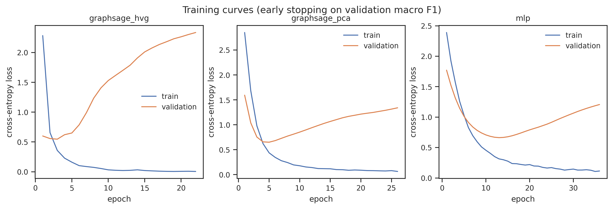
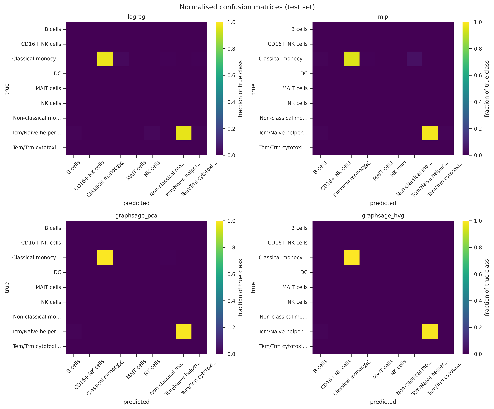

# Comparative study: GNN vs classical ML for cell-type classification

*Generated on 2026-10-01 by `src/evaluate.py` at the
end of `bash run_all.sh`. All parameters are in `config/config.yaml`.*

## Setup

- **Data**: 10x Genomics PBMC 3k — 2623 cells, 9
  fine-grained labels (CellTypist `Immune_All_Low`, majority voting),
  26 Leiden clusters.
- **Graph**: cell-cell k-NN in PCA space (k=15),
  69094 directed edges.
- **Evaluation protocol**: whole-cluster holdout — train
  2171 / val 146 /
  test 306 cells. Test labels:
  Classical monocytes, Tcm/Naive helper T cells. Labels eligible for holdout:
  Classical monocytes, Tcm/Naive helper T cells, Tem/Trm cytotoxic T cells (all others are train-only,
  see README for the rationale).
- **Same split, same seed** for all four models; torch models early-stopped on
  validation macro F1.

## Results

| model | features | seed | val_macro_f1 | test_accuracy | test_macro_f1 | train_time_s |
|---|---|---|---|---|---|---|
| logreg | pca | 42 | 0.1632 | 0.9673 | 0.2807 | 0.059 |
| mlp | pca | 42 | 0.2617 | 0.9575 | 0.3271 | 0.546 |
| graphsage_pca | pca | 42 | 0.353 | 0.9935 | 0.4982 | 0.393 |
| graphsage_hvg | hvg | 42 | 0.2632 | 0.9967 | 0.665 | 0.633 |

|  |  |
|---|---|

## Per-class F1 on the held-out clusters

Only the labels actually present in the test set are shown (the others are
train-only by design):

| true label | logreg | mlp | graphsage_pca | graphsage_hvg |
|---|---|---|---|---|
| Classical monocytes | 0.985 | 0.972 | 0.998 | 1.0 |
| Tcm/Naive helper T cells | 0.98 | 0.99 | 0.995 | 0.995 |

## Error analysis

- **Classical monocytes → Non-classical monocytes** (10 cells across 3 model(s)): a same-lineage continuum of myeloid states separated by few genes.
- **Classical monocytes → DC** (5 cells across 2 model(s)): two myeloid populations with overlapping antigen-presentation machinery.
- **Tcm/Naive helper T cells → B cells** (4 cells across 4 model(s)): not an expected same-lineage pair — at this cell count it is most likely label noise at a cluster border.
- **Classical monocytes → B cells** (2 cells across 1 model(s)): not an expected same-lineage pair — at this cell count it is most likely label noise at a cluster border.

Most confusions are between closely related lineages, but note the cross-lineage errors: Tcm/Naive helper T cells → B cells (4 cells).

## When does the GNN win?

**The GNN wins on this task.** Its best variant (graphsage_hvg, test macro F1 0.665) beats the best classical baseline (mlp, 0.327) by +0.338 macro F1. The win is mechanistically plausible: the dominant errors of per-cell classifiers are same-lineage confusions (see error analysis), and message passing over the k-NN graph smooths exactly these cluster borders.

Honest caveats that bound this conclusion:

- the validation set selects **graphsage_pca** while the test set ranks **graphsage_hvg** first — with 146 val cells spanning 2 labels, model selection itself is noisy and the val/test ranking inversion is expected rather than alarming
- the test set holds 306 cells over 2 labels, so single misclassified cells move macro F1 visibly
- macro F1 is computed over the union of true and predicted labels: every error scattered into an absent class adds a zero-F1 class, which is why macro F1 looks low next to accuracy
- ground truth comes from CellTypist majority voting — label noise at cluster borders bounds every model from above
- the graph is transductive (built from all cells' features, labels masked); an inductive variant would be stricter still
- results are single-seed (config `seed: 42`)

## Reproducibility

`bash run_all.sh` regenerates everything (data download included). Software
versions and the device used are logged in `results/environment.txt`; every
training run is appended to `results/experiments.csv`.
